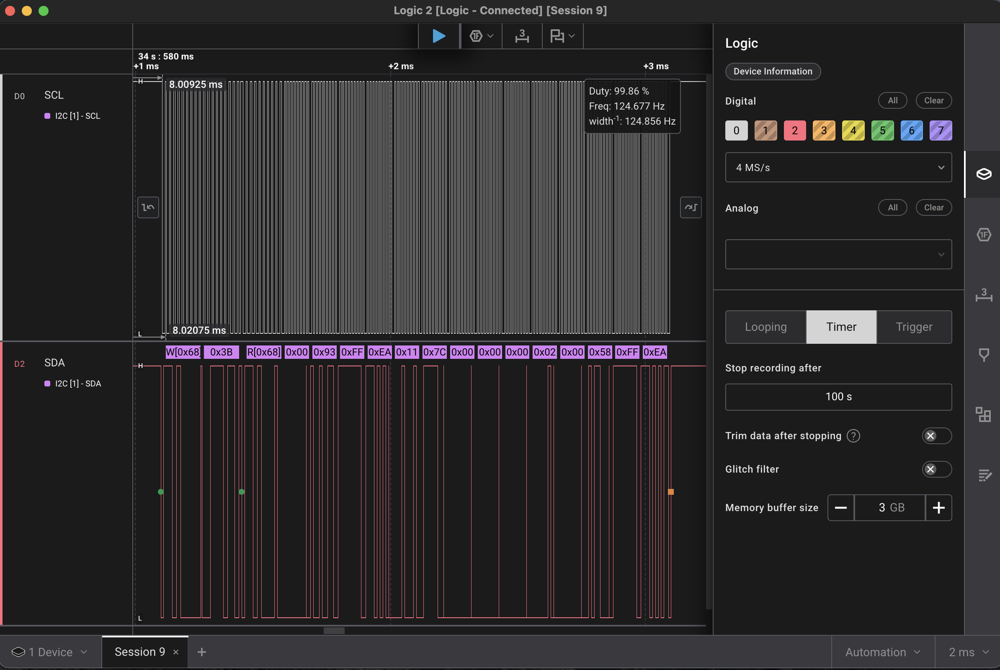

# Vital Stack : Bare-Metal Vital Signs Data Logger

A real time physiological monitoring system built on ESP32, written entirely in C without any HAL abstraction. Every driver — I2C, MAX30102, MPU6050 — was written from scratch by reading the datasheet, understanding every register, and deriving every bit value before writing a single line of code.

---

## What it does

- Reads heart rate and SpO2 data from the MAX30102 optical sensor
- Reads 6-axis motion (3-axis acceleration + 3-axis rotation) from the MPU6050 IMU
- Runs a FreeRTOS task triggered by a hardware interrupt from the MAX30102, not polling

> **Current build: MPU6050-only test mode.** `app_main.c` skips the MAX30102 and the sensor task polls the MPU6050 at 100 Hz with `vTaskDelayUntil()` (no INT pin needed), printing readings 10 times per second. The MAX30102 driver is unchanged and will be brought back on the same bus.

---

## Project

Every register write has a reason. Every bit field was derived from the datasheet. The I2C driver generates START, STOP, ACK, and NACK conditions manually using GPIO bit-banging, and recovers a stuck bus at startup with 9 clock pulses and a STOP. The sensor drivers know nothing about FreeRTOS. The FreeRTOS task knows nothing about I2C. Each layer does exactly one job.

The goal wasn't to build the most sophisticated health monitor. It was to learn and write firmware from scratch.

---

## System Architecture

```
MAX30102 (PPG sensor) ───I2C──┐
                              ├── ESP32 (FreeRTOS)
MPU6050 (6-axis IMU)  ───I2C──┘        │
                                       └── GPIO4 (INT pin) ──► ISR ──► Binary Semaphore ──► Sensor Task
```

**Task flow (full system):**
1. MAX30102 finishes a new averaged sample (100 sps with 4-sample averaging ≈ every 40 ms) and raises `PPG_RDY`
2. INT pin pulls low → ISR fires → gives binary semaphore → immediate context switch
3. FreeRTOS sensor task wakes → reads MAX30102 FIFO → reads MPU6050 (accel + gyro in one 14-byte burst)
4. Calculates acceleration magnitude `√(ax² + ay² + az²)` and checks the gyro rates
5. If `|magnitude − 1g| > 0.3g` or any axis exceeds 30 °/s → PPG sample flagged as motion-corrupted
6. Task blocks again, waiting for next interrupt

**Task flow (current MPU6050-only test build):** the task wakes every 10 ms, reads the MPU6050, runs the same motion check, and prints every 10th sample:

```
A[g]   0.04  -0.00   1.09 |a|= 1.09  G[dps]     0.1     1.2    -0.4  still
A[g]   0.12  -0.05   1.12 |a|= 1.12  G[dps]     1.4    -6.8   112.4  MOTION
```

---

## Hardware

| Component | Role | Interface |
|---|---|---|
| ESP32 (Acebott MAX V1) | Main controller | — |
| MAX30102 | Heart rate + SpO2 | I2C (0x57) |
| MPU6050 | 6-axis IMU (accel ±8g, gyro ±500 °/s) | I2C (0x68) |

**Wiring:**

```
ESP32 GPIO18 → SDA (both sensors)
ESP32 GPIO19 → SCL (both sensors)
ESP32 GPIO4  → MAX30102 INT   (not used in the MPU6050-only test build)
ESP32 3V3    → VCC (both sensors)
ESP32 GND    → GND (both sensors)
MPU6050 AD0  → GND or unconnected (pulled down on the board → address 0x68)
```

The pins are set in `i2c.c` (`SDA_PIN`, `SCL_PIN`). On the Acebott board the printed header labels do not match the GPIO numbers — verify the physical pin with a toggle test before wiring. Most MPU6050 breakouts (GY-521) already have SDA/SCL pull-ups; add 4.7 kΩ to 3.3 V only if yours doesn't.

---

## Challenges

### 1. I2C_CONFIG Open Drain Error
Both sensors failed their part ID checks on first boot — the MAX30102 returned `0x00` instead of `0x15`, and the MPU6050 returned `0x00` instead of `0x68`. 

The I2C pins were configured as `GPIO_MODE_OUTPUT_OD`, which enables open-drain output but **disables the input buffer**. On the ESP32, `gpio_get_level()` on a pin with input disabled always returns 0. So every bit read from SDA was 0 — every part ID read `0x00`, every FIFO sample read zero, and every ACK bit read as 0, which made every register write look like it succeeded. The fix was one word: `GPIO_MODE_INPUT_OUTPUT_OD`.

Lesson: a bus that reports *perfect* success on every transaction is as suspicious as one that fails on every transaction.

### 2. Debugging with a multimeter, a logic analyzer, and a toggle test

After the open drain fix, an I2C scan found zero devices. The debugging went layer by layer:
- **Multimeter:** continuity on every wire, no shorts to GND, VCC = 3.3 V, SDA/SCL idle at 3.3 V — wiring looked fine.
- **Logic analyzer:** both lines flat during the scan. Shorting each probe to GND proved the analyzer itself worked.
- **GPIO toggle test:** firmware toggling GPIO18/19 once a second while the analyzer stayed flat proved the wires were on the wrong header pins — the board's labels don't match the GPIO numbers.



Once the wires were on the real GPIO18/19, the scan found `0x68` with `WHO_AM_I = 0x68` — a genuine MPU6050. The logic analyzer now decodes each read as one clean transaction: `W[0x68] 0x3B → R[0x68]` + 14 bytes.

### 3. Understanding what "sleep mode" actually means

The MPU6050 boots in sleep mode by default — the datasheet says this clearly. The sensor signal paths are powered down in sleep. Writing `PWR_MGMT_1` clears the SLEEP bit and wakes the device. Without this, every register read returns stale or zero data, and it looks like an I2C problem when it isn't. With the gyro enabled, the clock source is also switched to the X-gyro PLL (`CLKSEL = 001`), which is more stable than the internal oscillator.

### 4. Binary semaphore vs global flag

The first instinct for ISR-to-task signaling was a `volatile uint8_t flag`. A global flag works, but the task has to poll it constantly — burning CPU doing nothing useful. A FreeRTOS binary semaphore lets the task sleep completely between interrupts and wake instantly when the ISR fires.

### 5. Motion threshold vs gravity

The first motion check flagged samples when `|a| > 1.5g`. But at rest `|a|` is already 1g from gravity, so that only caught large jolts and missed motion that *reduces* the magnitude. The check now uses the deviation `|magnitude − 1g|`, and adds the gyroscope so pure rotation (which barely changes `|a|`) is caught too.

---

## Next steps
- **MAX30102 re-test:** now that the I2C bug is fixed, bring the MAX30102 back on the same bus.

---

## Hardware Photos

### Sensors


### Full Setup


---

## Built with

- ESP-IDF v5.5.2
- FreeRTOS (bundled with ESP-IDF)
- C99
- A lot of datasheet reading
- A multimeter, a logic analyzer, and a GPIO toggle test
